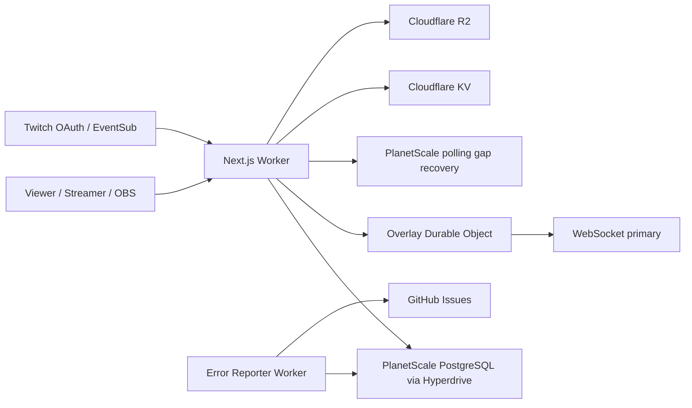

# 現行アーキテクチャ

twica の永続データは PlanetScale PostgreSQL を唯一の正本とし、Cloudflare Workers
から Hyperdrive 経由で接続します。段階移行で使用した Supabase／PostgREST 経路と
runtime driver flag はコードから撤去済みです。

## 境界

- DB access は `src/lib/db/client.ts` から PlanetScale／Drizzle を使用する。
- overlay は Durable Objects WebSocket を primary、PlanetScale polling を
  reconnect 時の gap recovery とする。
- Twitch credential refresh は外部 API を DB transaction に含めず、旧 refresh
  token 条件の CAS update で競合時の上書きを防ぐ。
- 本体 Worker、overlay Worker、error reporter Worker の生成 bundle は
  `npm run check:supabase-shutdown` で廃止済み provider の再混入を拒否する。
- 旧切替手順は `docs/history/` の記録であり、現在の運用へ適用しない。

## 設定

- local Next.js: `DATABASE_URL_PLANETSCALE`
- production / preview Worker: `HYPERDRIVE_PLANETSCALE`
- migration workflow: GitHub Environment の `PLANETSCALE_DATABASE_URL`

接続文字列をソース、`.env`、公開 build variable へ保存しません。Cloudflare に残る
旧 Secret は PG/DO-only release の観測期間を完了して利用ゼロを確認した後、preview、
production の順で削除します。コード撤去と Secret revoke を同時に行わないことで、
障害時の原因を切り分けます。

## Workers Cache

- Workers Cache（`[cache] enabled = true`、wrangler.toml）の公開対象は
  `src/middleware.ts` の `CACHEABLE_PUBLIC_PATHS` に限定し、それ以外の全
  レスポンスへ middleware が `private, no-store` を fail-closed 付与する。
- 公開 GET が `Cache-Tag` / `Cache-Control: public` を発行する場合、無効化は
  保存側 route が `caches.default.delete()` で正規 URL を削除する
  best-effort purge（`src/lib/cache-control.ts`）。Cache-Tag 指定の purge は
  Zone API（API トークン）が必要で Worker ランタイムからは呼べず、
  `cloudflare:workers` も OpenNext の route handler ビルドでは解決できない
  ため、タグは発行しつつ URL 単位の削除で運用する。
- `Set-Cookie` と `public` の共存方針: 公開 GET route は cookie を発行しない。
  middleware の `updateSession` がセッション異常時の Cookie 削除で
  `Set-Cookie` を付けることがあるが、Cloudflare Workers Cache は既定で
  `Set-Cookie` を含む応答をキャッシュしないため、その応答は1回だけ素通り
  する。この既定挙動への依存を明示的な方針とし、`cache.put` 等で
  `Set-Cookie` 応答を強制保存する変更を入れる場合はこの前提を見直す。
